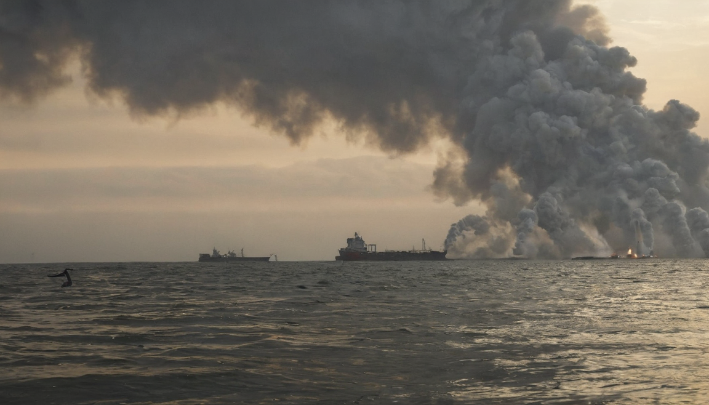

# news-image-20261122 — "Gulf dawn"

Summing up 22 November 2026 world news in one image: at dawn, an Iranian
attack has set a civilian industrial facility on the Bahraini shoreline
ablaze — thick smoke columns over the water while firefighters spray jets
from a distance — oil tankers burn on the Hormuz-strait horizon, and a
single fighter contrail crosses the amber morning sky. Rendered with a
deterministic SDXL pipeline (fixed seed, RealVisXL V4.0); the bundled
photograph is the completed artwork.



## Program

`main.py` is an offline, stdlib-only Python 3.13 program that copies
`bundled_entry.png` to `$MAKEFUN_OUTPUT_DIR/entry.png` (default `./output`),
prints the destination path and byte size, and exits nonzero if the bundled
image is missing or larger than 1 MiB.

```bash
python main.py            # writes ./output/entry.png
```

Run twice with different `MAKEFUN_OUTPUT_DIR` values and `cmp` the results —
both runs are byte-identical (deterministic).

## License

MIT — see [LICENSE](LICENSE).
